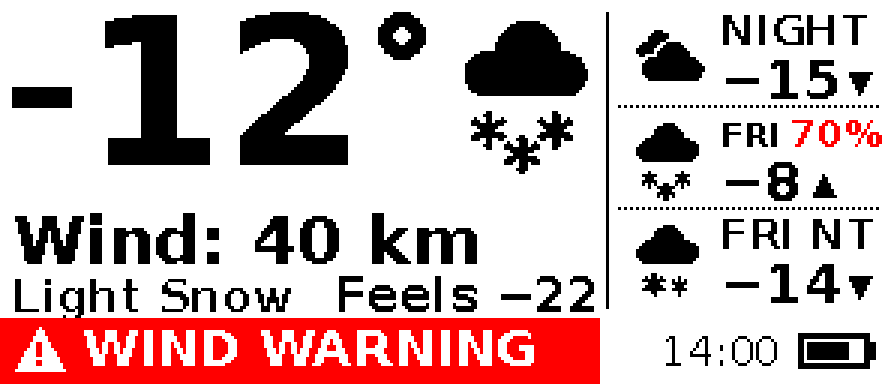
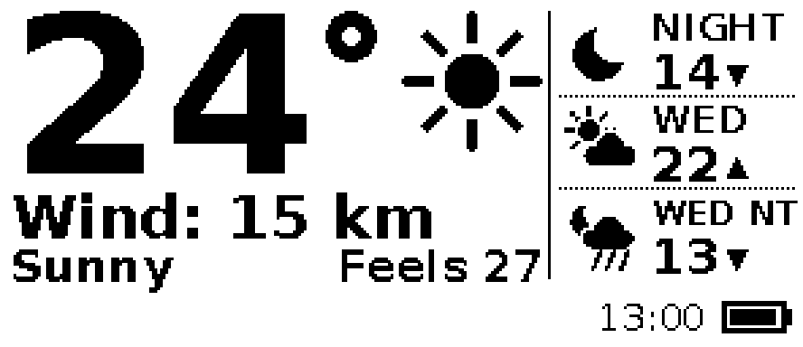
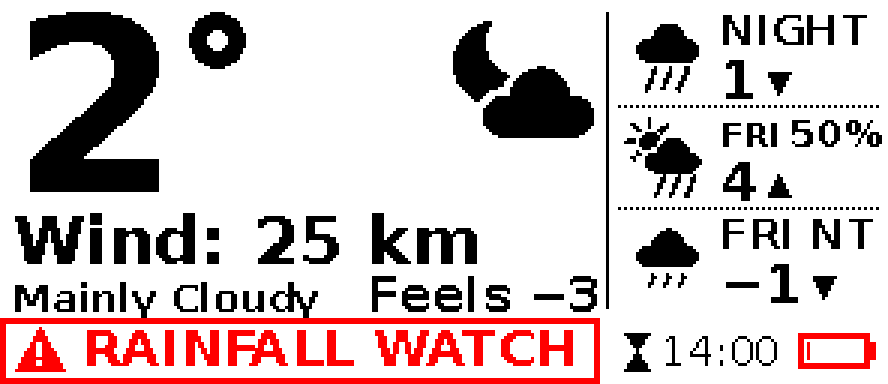

# Display layout (296x128 landscape)

Renderer: `host/wxd/render.py`. Previews: `python -m wxd.render` (writes `host/out/`). Pixel pitch is about 0.227 mm.

## Grid (px, origin top-left)

| Region | Box | Content |
|---|---|---|
| Temperature | x 4.., y 4..64 | DejaVu Sans Bold, auto-shrunk (max digit height 60 px, about 13.6 mm). Minus bar and degree ring are drawn, not glyphs. |
| Current icon | x 202..258, y 2..58 | 56 px procedural icon |
| Wind | baseline y 88 | Bold 22 px (cap about 16 px, 3.7 mm): sustained speed only, `Wind: 9 km` ("/h" implied; `Wind: Calm`, `Wind: --`). Direction and gusts are deliberately omitted (user preference, 2026-11-05). Shrinks to 16 px if too wide; `Wind: 100 km` fits at 22 px. |
| Condition | baseline y 104, x 4.. | Bold 17 px, shrinks to 13 px to fit beside "Feels", then ellipsis |
| Feels-like | baseline y 104, right-aligned to x 200 | Bold 16 px |
| Forecast column | x 206..296, 3 rows of 34 px, divider at x 202 | 28 px icon, name bold 14 px (shrinks to 10), temp bold 18 px with triangle (up = high, down = low), POP in bold 13 px on the name line when >= 40 % |
| Footer | y 106..128 | Alert banner (left), else today's forecast high/low as `H: 6° | L: 3°` (bold 18 px, shrinks to 13 px to fit; `--` if missing); observation time (regular 14 px), hourglass if stale, battery 24x12 |

## Color rules

Red is used only for: warning banner (solid red, white text), watch/advisory/statement banner (red outline, red text), POP >= 70 %, feels-like <= -30 or >= 35, low battery (<= 15 % or device low flag). Everything else is black on white. There is no grey or dithering. Text is drawn with anti-aliasing off. Icons are drawn 4x supersampled and thresholded.

## Readability rationale

At 1-2 m, a 3.5 mm cap height (about 15 px) is the practical floor, so primary text is 16 px or more. The temperature digits are about 13 mm tall. Only the observation time (14 px) and POP (13 px) are smaller, and both are secondary. The layout has few elements, and the order of reading is temperature, wind, forecast, then alert. The observation time shown is the data's own time, not the render time, so the image only changes when the data changes (this avoids needless panel refreshes). A hourglass appears when the observation is more than 3 h older than `now`.

## Panel rotation

`rotate=90`: native (0,0) is the landscape top-right corner. `rotate=270`: native (0,0) is the landscape bottom-left corner. See `to_planes` in `render.py`.

## Fonts and licenses

DejaVu Sans and Sans Bold (Bitstream Vera license, license text in `host/wxd/assets/DejaVu-LICENSE.txt`) are vendored so output is the same on every host. Icons are drawn procedurally, so no icon font license applies.
