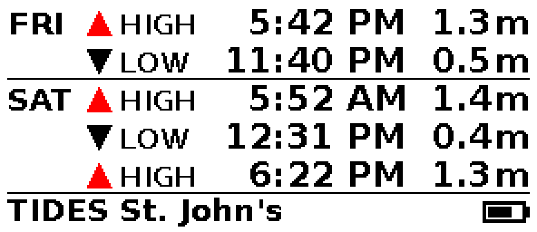

# Tide view

Code: `host/wxd/tides.py` (fetch/parse), `host/wxd/render_tide.py` (image). Preview: `python -m wxd.render_tide` writes `docs/img/tide-preview.png` from the fixture.

## Data source

Canadian Hydrographic Service IWLS API, no key. St. John's is station code `00905`, id `5cebf1e33d0f4a073c4bc176` (hardcoded default; `resolve_station_id()` looks it up from `GET /api/v1/stations?code=00905`).

`GET https://api-iwls.dfo-mpo.gc.ca/api/v1/stations/{id}/data?time-series-code=wlp-hilo&from=...Z&to=...Z`

Returns `[{"eventDate": "2026-11-06T02:28:00Z", "value": 0.551, ...}]`, heights in metres above chart datum, times UTC. The fetch window is now-1 day to now+3 days so that edge events can be classified. The API accepted windows of at least 4 months in testing. No rate limit was seen; one fetch every few hours is enough (predictions are static).

## Parsing

Entries without a valid `eventDate` or numeric `value` are skipped; duplicates collapse; events are sorted. Times convert to America/St_Johns. The API does not say high or low, so an event is HIGH if its height exceeds both neighbours (endpoints compare with their single neighbour). An empty result or HTTP failure raises `TideError`; the caller should keep its last model.

## Layout

Up to 5 rows (21 px each), only events at or after `now`: day label (first row and on each day change, with a divider line), triangle (red up = HIGH, black down = LOW), HIGH/LOW word, 12 h time, height in m (19 px bold). Footer: `TIDES <station>`, hourglass if the data is older than `RenderConfig.stale_after`, battery icon. No curve or "now" marker.

## Refresh behaviour

The device refreshes the panel only when the image CRC changes. The image depends only on the data, the next 5 events, the first-row day label, battery level and the stale flag. It stays byte-identical until an event passes (about every 6 hours), the day label rolls, or the battery icon changes. The footer shows no fetch time, so refetching unchanged data does not change the image.
